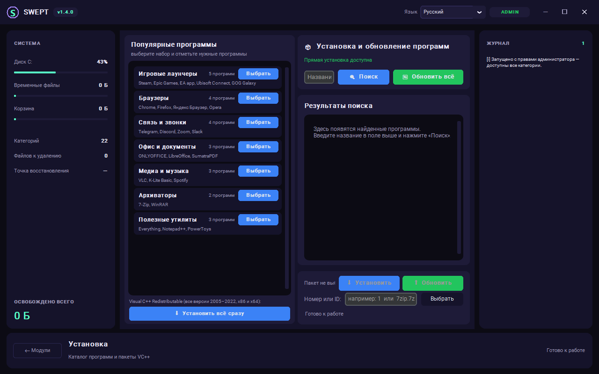
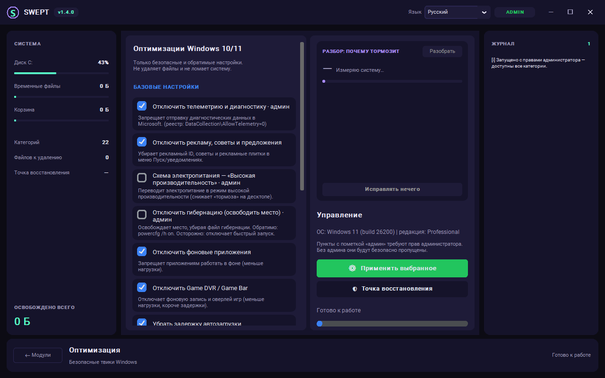

# Swept

[](LICENSE)
[](https://github.com/vladcodex/swept)
[](https://github.com/vladcodex/swept/releases/latest)
[](https://github.com/vladcodex/swept)

**One window to clean, install and tune Windows 10/11 — safely.**

Free and open source, with a dark bilingual interface (Русский / English):

- 🧹 **Clean** — temp files, browser caches, Windows Update cache, Recycle Bin, logs, dumps
  and game-launcher junk. Analyze first, delete only what you confirm.
- 📦 **Install** — search and install any `winget` package, update everything at once, or
  pick individual apps from 7 curated sets (25 packages).
- ⚡ **Optimize** — 12 safe Windows tweaks (telemetry, power plan, background apps, Game DVR,
  widgets…) with a system restore point created before any change.

No telemetry, no bundled offers, no background services — and every deleted file and
changed setting is written to the log.

**[⬇ Download the latest release](https://github.com/vladcodex/swept/releases/latest)** —
either the portable `Swept.exe` (just run it) or `Swept-Setup-1.1.1.exe` (a normal Windows
installer with a Start Menu shortcut and a proper uninstaller).


---

## Contents

- [What it does](#what-it-does)
- [Safety model](#safety-model)
- [Requirements](#requirements)
- [Run from source](#run-from-source)
- [Build a single .exe](#build-a-single-exe)
- [Build the installer](#build-the-installer-optional)
- [Command line](#command-line)
- [Project layout](#project-layout)
- [Localization](#localization)
- [Limitations](#limitations)
- [Found a bug?](#found-a-bug)
- [Questions and ideas](#questions-and-ideas)
- [Disclaimer](#disclaimer)
- [License](#license)
- [По-русски](#по-русски)

---

## What it does

### 🧹 Cleanup

| Group | Categories |
|---|---|
| Quick cleanup | User temp (`%TEMP%`), system temp (`C:\Windows\Temp`), Windows update cache, `.log` / `.dmp` files, Recycle Bin |
| Browser cache | Chrome, Yandex Browser, Edge, Firefox — cache, history, cookies |
| Game launchers | Steam, Epic, Ubisoft Connect, EA App, Battle.net, GOG Galaxy — caches, logs, temp data |

- **Analyze first, delete later.** The Analyze button only measures; nothing is touched until you press Clean.
- **Scan-only switch.** Even the Clean button can run in simulation mode.
- **Live log** with the full path of every deleted or skipped file.
- Running browsers are detected and skipped instead of being broken mid-session.

### 📦 Install and update

- Search any package in the `winget` catalog and install it by clicking a row.
- Update a single package, or everything installed at once.
- **Popular app sets** in a column on the left: office, viewers and printing, browsers,
  archivers, media and codecs, chat and calls, handy utilities — 25 packages in total.
  A set is only a hint: **Choose** opens a list of its programs with checkboxes, so you
  install exactly what you need, not the whole bundle. Every package ID is verified
  against the winget catalog.
- **One-click Visual C++ Redistributable bundle** — all versions 2005–2022, x86 and x64, installed in sequence.



### ⚡ Optimize

Twelve safe tweaks in two groups — before any change Swept creates a system restore point:

- **Basic settings** — telemetry, advertising ID and suggestions, high-performance power plan, hibernation, background apps, Game DVR, startup delay, visual effects.
- **Full debloat** — built-in promo/game apps (Weather, News, Maps, Skype, Solitaire, Candy Crush…), taskbar widgets and Copilot, web search suggestions, Windows Error Reporting.

Every item states what it changes and whether it needs administrator rights; before applying, Swept makes a system restore point.

While the run is going, the **Progress** panel lists every selected item and marks it live:
`⏳` being applied now (with a "3 of 8" counter and the item name), `✔` done, `⛔` skipped or
unavailable — with the reason written right into the row — and `⚠` failed.

**Restore point** (`🛡`) — Swept creates a Windows system restore point (PowerShell
`Checkpoint-Computer`) **before** applying any tweak, so you can always roll back through
the standard *Control Panel → Recovery* path. There is also a dedicated **Restore point**
button to create one at any time, without applying optimizations. Built-in apps removed by
the debloat step cannot be restored automatically — the app says so and points to Microsoft Store.
From the command line: `python cleaner_optimize.py --apply telemetry`.



---

## Safety model

Swept is built around the assumption that a cleaner must never be able to eat your system:

1. **Whitelist first.** A file is deleted only if it is inside a folder produced by the
   category's own job list — never by a free-form path.
2. **Hard blacklist.** `System32`, `WinSxS`, `Fonts`, `servicing`, `Program Files`, the Recycle Bin
   folder itself and similar locations are never entered. Narrow exceptions exist for
   `System32\LogFiles`, `winevt\Logs` and specific Steam cache folders.
3. **Protected files.** `pagefile.sys`, `hiberfil.sys`, `bootmgr`, `ntuser.dat`, `bcd` and friends
   are refused by name.
4. **Dry run by default in the CLI**, one explicit confirmation in the GUI before real deletion.
5. **Errors never stop the run** — a locked file is counted as "skipped", not as a crash.
6. **No network access** except `winget` calls initiated by you, and no data collection of any kind.
7. **Links are never followed.** Junctions, symlinks and other reparse points are skipped during
   scanning and refused during deletion. A `%TEMP%` junction pointing at `Documents` would otherwise
   turn "clear temporary files" into "delete my documents" — so the real target path is checked
   against the whitelist as well, and personal folders (`Documents`, `Desktop`, `Downloads`,
   `Pictures`, OneDrive…) are refused even when they appear inside an allowed root.
8. **No `PATH` lookups for elevated tools.** The packaged app runs as administrator, so `winget`,
   `powercfg`, `tasklist` and `powershell` are resolved to their real files in
   `Program Files\WindowsApps` and `%SystemRoot%\System32` instead of being taken from `PATH`,
   where a planted executable would inherit elevation.
9. **Validated arguments.** Package IDs are matched against `[A-Za-z0-9][A-Za-z0-9._+-]*`, so a value
   from the input field can never become a `winget` switch (`--help`, `-e`) or smuggle quotes and
   spaces into the command line; search queries may not start with a dash.

Administrator rights are optional. Without them, `C:\Windows\Temp` and the update cache are
skipped; the app tells you so instead of failing silently. The packaged `.exe` requests
elevation through its manifest.

---

## Requirements

- Windows 10 or 11
- Python 3.10+ (developed and tested on 3.15) with `tkinter`
- `customtkinter` (installed from `requirements.txt`)
- `winget` (App Installer from the Microsoft Store) — only for the Install tab

Administrator rights are optional. Without them the system locations (`C:\Windows\Temp`,
the update cache) are skipped and reported instead of failing silently.

## Run from source

```bat
git clone https://github.com/vladcodex/swept.git
cd swept
python -m venv .venv
.venv\Scripts\pip install -r requirements.txt
.venv\Scripts\python cleaner_gui.py
```

## Build a single .exe

```bat
.venv\Scripts\pip install pyinstaller
.venv\Scripts\python build.py
```

The result is `dist\Swept.exe` — one file, no console window, custom icon, version resource
and a `requireAdministrator` manifest.

Useful flags:

```bat
python build.py --no-admin    :: do not request elevation
python build.py --onedir      :: folder build, faster startup
python build.py --console     :: keep the console for debugging
```

The build environment must have `customtkinter` installed: the GUI imports it inside a
`try/except ImportError`, so PyInstaller otherwise treats it as optional and leaves it out.

### Build the installer (optional)

`dist\Swept.exe` is a portable program — it runs without being installed. If you want a
classic Windows setup with a Start Menu shortcut and an entry in *Apps & Features*,
compile the Inno Setup script:

```bat
winget install JRSoftware.InnoSetup
"C:\Program Files (x86)\Inno Setup 6\ISCC.exe" installer\setup.iss
```

The result is `dist\Swept-Setup-1.1.1.exe` — a bilingual (RU/EN) installer that asks for
administrator rights, installs to `Program Files`, and offers a desktop shortcut as an
optional task. It also ships `README.md` and `LICENSE` next to the program.

---

## Command line

The three modules also work on their own — handy for scripts and scheduled tasks.

```bat
:: scan only, nothing is deleted
python cleaner_core.py --scan --only temp_user,chrome,recycle

:: real cleanup, no questions asked
python cleaner_core.py --clean --only recycle --yes

:: package management
python cleaner_installer.py --search 7zip
python cleaner_installer.py --install 7zip.7zip
python cleaner_installer.py --upgrade-all --dry-run

:: reversible Windows tweaks
python cleaner_optimize.py --list
python cleaner_optimize.py --apply telemetry,advertising,search_suggest
python cleaner_optimize.py --apply telemetry,advertising,search_suggest   :: apply selected tweaks
```

## Project layout

| File | Purpose |
|---|---|
| `cleaner_gui.py` | CustomTkinter interface, worker threads, message queue |
| `cleaner_core.py` | Categories, scanning, safe deletion, Recycle Bin |
| `cleaner_installer.py` | `winget` wrapper: search, install, upgrade, VC++ bundle |
| `cleaner_optimize.py` | Registry and `powercfg` tweaks, Windows version detection |
| `cleaner_i18n.py` | Interface strings (RU/EN), language switching, unit formatting |
| `cleaner_settings.py` | Settings storage: `HKEY_CURRENT_USER\Software\Swept`, JSON fallback |
| `build.py` | PyInstaller wrapper with icon, version resource and manifest |
| `installer/setup.iss` | Optional Inno Setup script — a classic Windows installer (Start Menu shortcut, uninstaller) |

## Localization

The interface ships with Russian and English. The language is chosen from a dropdown in the
header and switches **instantly, without restarting** — every widget is rebuilt in place.

**Where the choice is stored** (Reg Organizer style): the registry, not a config file.

```
HKEY_CURRENT_USER\Software\Swept
    Language    REG_SZ    "ru" | "en"
```

- `HKCU` needs no administrator rights, and the setting follows the user, not the folder —
  move the exe anywhere and the language stays.
- On start the value is read from the registry; if it is missing, Russian is used.
- Selecting a language writes the new value immediately (`winreg`, `REG_SZ`).
- A `settings.json` written by versions before 1.1 is migrated into the registry once;
  if the registry is unavailable (policy, non-Windows), the file is used as a fallback.

To add a language:

1. Copy the `"en"` block in `cleaner_i18n.py` under a new language code and translate the values.
2. Add `title_en`-style fields (`title_xx`, `desc_xx`) to the data in `cleaner_core.py` and
   `cleaner_optimize.py`, or extend `i18n.fld()` with your suffix.
3. Add the code to `LANGUAGE_NAMES` and `LANGUAGE_ORDER` so it appears in the dropdown.
4. Add it to `SUPPORTED_LANGUAGES` in `cleaner_settings.py` so it can be stored.

## Limitations

- Registry tweaks are written directly; Windows may re-apply some of them after a feature update.
- Recent Windows 11 builds (24H2 and later) protect some shell values — for example `TaskbarDa`
  and `AllowNewsAndInterests` — at the OS level: the key ACL grants full control, yet the write is
  refused. Swept reports such an item as **unavailable on this Windows build** instead of calling it
  an error or blaming missing administrator rights.
- The Install tab depends on `winget` output parsing, which Microsoft changes from time to time.
- The `.exe` is not code-signed, so SmartScreen may warn about an unknown publisher on first run.

## Found a bug?

Please report it — that is how the program gets fixed:
**[github.com/vladcodex/swept/issues](https://github.com/vladcodex/swept/issues)**

To make a report useful, include:

- what you did and what you expected to happen,
- what actually happened instead,
- your Windows version (e.g. Windows 11 24H2) and whether Swept ran as administrator,
- the last lines of the **Log** tab (the app never sends anything anywhere — the log stays on your machine).

## Questions and ideas

For anything that is not a bug — how something works, what a setting means, a feature you
would like to see — there is
**[Discussions](https://github.com/vladcodex/swept/discussions)**:

- **Q&A** — ask how the program behaves and why.
- **Ideas** — propose a feature or an improvement.
- **General** — everything else.

Bugs belong in Issues, everything else in Discussions — that keeps the bug list clean and
the status of each report visible.

---

## Disclaimer

Swept deletes files and changes Windows settings. It is built conservatively and tested, but
you use it at your own risk — keep backups of anything you cannot re-download. The authors
take no responsibility for data loss or system damage.

## License

[MIT](LICENSE) — free to use, modify and redistribute. The app itself is free, with no
paid tier and no bundled offers.

---

## По-русски

**Swept** — бесплатная утилита с тёмным интерфейсом на двух языках (русский / English) в одном окне:

- 🧹 **Очистка** — временные файлы, кэш браузеров, кэш обновлений Windows, Корзина, логи,
  дампы и мусор игровых лаунчеров. Сначала «Анализ» — удаление только по вашему подтверждению.
- 📦 **Установка** — поиск и установка любого пакета из `winget`, обновление всех программ
  сразу или выбор отдельных программ из 7 готовых наборов (25 пакетов).
- ⚡ **Оптимизация** — 12 безопасных настроек Windows (телеметрия, схема электропитания,
  фоновые приложения, Game DVR, виджеты…) с созданием точки восстановления перед изменениями.

Никакой слежки, никаких встроенных предложений и фоновых служб — один `.exe`, а каждое
удалённый файл и каждая изменённая настройка попадают в журнал.

**Нашли баг?** Напишите об этом — именно так программа и исправляется:
[github.com/vladcodex/swept/issues](https://github.com/vladcodex/swept/issues).
Чтобы отчёт был полезен, опишите: что вы делали и чего ожидали, что произошло на самом деле,
версию Windows (например, Windows 11 24H2), были ли права администратора, и последние
строки вкладки «Журнал» (программа ничего никуда не отправляет — журнал остаётся у вас).

**Вопросы и идеи** — если это не баг: как что-то работает, что означает настройка, какую
функку добавить. Для этого есть
[Discussions](https://github.com/vladcodex/swept/discussions): **Q&A** — вопросы,
**Ideas** — предложения, **General** — всё остальное. Баги — в Issues, всё прочее —
в Discussions: так список багов остаётся чистым, а статус каждого отчёта виден.

Выбранный язык хранится в реестре (как в Reg Organizer):

```
HKEY_CURRENT_USER\Software\Swept
    Language    REG_SZ    "ru" | "en"
```

Права администратора для записи не нужны, настройка привязана к пользователю: exe можно
перенести в другую папку — язык останется. При запуске значение читается из реестра,
при его отсутствии выставляется русский. Старый `settings.json` (версии до 1.1) один раз
переносится в реестр.

- **Очистка** — 15 категорий: временные файлы, кэш обновлений, логи и дампы, Корзина,
  кэш/история/куки четырёх браузеров, кэши шести игровых лаунчеров. Сначала «Анализ» —
  удаление только по отдельной кнопке, есть режим симуляции.
- **Установка** — поиск пакетов в `winget`, установка и обновление, набор Visual C++
  Redistributable (2005–2022, x86 и x64) одной кнопкой. Слева — колонка наборов популярных
  программ (офис, просмотр и печать, браузеры, архиваторы, медиа, связь, утилиты — 25 пакетов).
  Набор только подсказывает: кнопка «Выбрать» открывает список программ с галочками, и
  ставится ровно то, что отмечено, а не весь набор целиком.
- **Оптимизация** — 12 безопасных настроек (перед изменениями создаётся точка восстановления):
  телеметрия, реклама, схема электропитания,
  гибернация, фоновые приложения, Game DVR, виджеты и Copilot, отчёты об ошибках и другое.
  Во время применения в панели «Ход выполнения» видно, какой пункт выполняется сейчас
  (со счётчиком «3 из 8») и чем закончился каждый: выполнено, пропущено, недоступно
  (с причиной прямо в строке) или ошибка.
- **Точка восстановления** — Swept создаёт точку восстановления Windows (PowerShell
  `Checkpoint-Computer`) **перед** применением любых настроек, поэтому откатить изменения
  можно штатными средствами — «Панель управления → Восстановление». Отдельная кнопка
  «🛡 Точка восстановления» создаёт её в любой момент, без применения оптимизаций.
  Удалённые встроенные приложения сами не возвращаются — их ставит Microsoft Store,
  о чём программа честно пишет в журнале. Из командной строки:
  `python cleaner_optimize.py --apply telemetry`.

Безопасность: белый список путей, жёсткий чёрный список (`System32`, `WinSxS`, `Program Files`…),
запрет на удаление системных файлов вроде `pagefile.sys`, ошибки не прерывают работу.
Ссылки и junction при сканировании не обходятся, а при удалении отклоняются; личные папки
(`Документы`, `Рабочий стол`, `Загрузки`, OneDrive) не чистятся никогда. Системные утилиты
(`winget`, `powercfg`, `tasklist`) запускаются по полному пути из защищённых каталогов, а не из
`PATH`, — подмена файла в пути поиска не даст повышенных прав. ID пакетов проверяются по шаблону,
поэтому ввод вида `--help` не превращается в ключ `winget`.

Запуск из исходников: `pip install -r requirements.txt`, затем `python cleaner_gui.py`.
Сборка exe: `python build.py` → `dist\Swept.exe`.
Установщик (Inno Setup): `ISCC.exe installer\setup.iss` → `dist\Swept-Setup-1.1.1.exe`.
