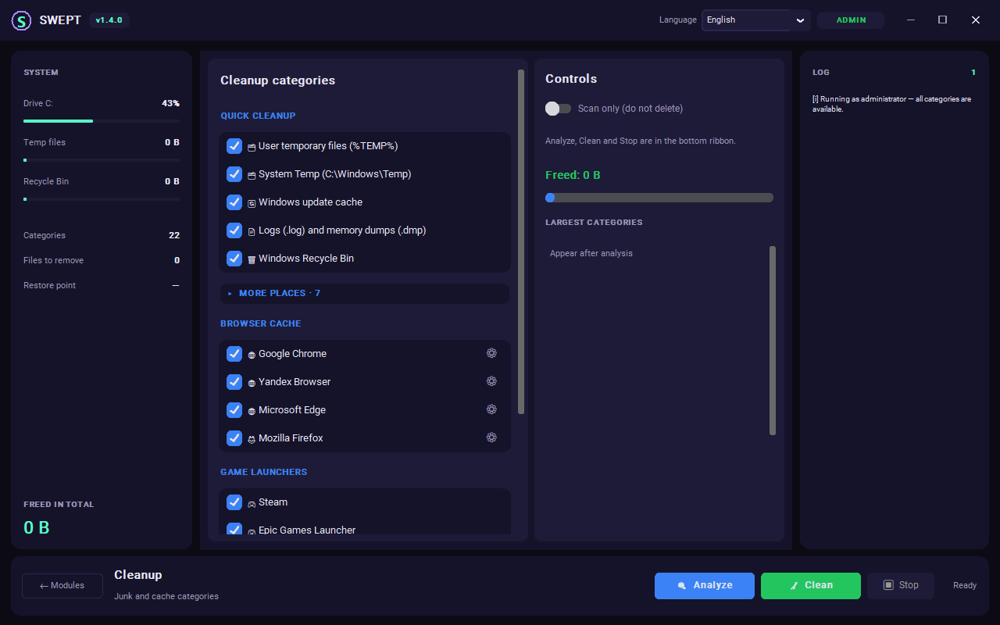

# Swept

**One window to clean, install and tune Windows 10/11 — safely.**

Free and open source, with a dark interface available in **two languages — English and Russian**
(the switch sits in the window header and the choice is remembered between runs):

- 🧹 **Clean** — temp files, browser caches, Windows Update cache, Recycle Bin, logs, dumps and
  game-launcher junk. Analyze first, delete only what you confirm.
- 📦 **Install** — game launchers, browsers, chat apps, office, media, archivers and utilities
  (24 programs), fetched straight from the vendor's own HTTPS CDN, verified by signature or pinned
  hash, installed silently from an isolated folder.
- ⚡ **Optimize** — 12 safe Windows tweaks (telemetry, power plan, background apps, Game DVR,
  widgets…) with a system restore point created before any change.
- ⏰ **Schedule** — quiet automatic cleanup: daily or weekly at a chosen time, dry run first,
  a restore point before deletion, and an optional Windows Task Scheduler task that runs Swept
  in the background even when the app is closed.

No telemetry, no bundled offers, no background services — and every deleted file and changed
setting is written to the log.

**[⬇ Download the latest release](https://github.com/vladcodex/swept/releases/latest)** — either
the portable `Swept.exe` (just run it) or the setup executable (a normal Windows installer with a
Start Menu shortcut and a proper uninstaller). What changed in each version is listed on the
releases page.

*Screenshot shows the English interface. The app ships with English and Russian and lets you
switch between them at any time.*

---

## About Swept

**Swept is a single-window maintenance toolkit for Windows 10/11.** Instead of five separate
utilities — a cleaner, a downloader, a tweaker, a scheduler and a log viewer — you get one
portable program with five tabs:

| Tab | What it is for |
|---|---|
| **🧹 Cleanup** | Frees disk space: temp files, browser caches, Windows Update cache, Recycle Bin, logs, dumps and game-launcher junk across 15 categories. Always analyzes before deleting. Also checks and cleans the WinSxS component store with the official DISM commands. |
| **📦 Install** | A curated catalog of 24 popular programs plus 12 Visual C++ Redistributable packages, fetched from the vendors' own CDNs and verified by signature or pinned hash before anything runs. |
| **⚡ Optimize** | 12 safe Windows tweaks (telemetry, power plan, background apps, Game DVR, debloat) with a system restore point created before any change. |
| **⏰ Schedule** | Quiet automatic cleanup: daily or weekly, dry run first, restore point before deletion, optionally driven by a Windows Task Scheduler task that runs Swept headless in the background. |
| **📋 Log** | The full history of every deleted file and changed setting, with reasons for everything that was skipped. |

**How it works under the hood:**

- Written in **Python** with a **CustomTkinter** dark interface, compiled to a self-contained
  Windows executable — no Python or runtime needs to be installed.
- **Two languages** (English and Russian), switched instantly in the window header and remembered
  between runs, stored per user.
- **Administrator rights are optional**: without them the system-level locations are skipped and
  reported instead of failing silently.
- **Settings live in the registry** (`HKCU\Software\Swept`), with a JSON file as a fallback on
  locked-down systems.
- The scheduled task runs the same executable in a **headless mode** (`Swept.exe --silent-clean`)
  that performs the whole pipeline — restore point, dry run, cleanup — and writes
  `swept_silent_clean.log` next to the binary.

**Privacy:** no telemetry, no analytics, no bundled offers, no background services. The only
network access is the HTTPS download you explicitly start from the Install tab, and every byte
of it is verified before it runs.

> **Not a virus.** The builds are not code-signed, so SmartScreen may warn about an unknown
> publisher on first run — an Authenticode certificate costs hundreds of dollars a year and this
> is a free, open-source project. The full source is public, every build is reproducible from it,
> and the program only ever deletes files inside its own whitelisted categories.

---

## Contents

- [About Swept](#about-swept)
- [What it does](#what-it-does)
- [Safety model](#safety-model)
- [Requirements](#requirements)
- [Interface languages](#interface-languages)
- [Limitations](#limitations)
- [Feedback](#feedback)
- [Disclaimer](#disclaimer)
- [License](#license)

---

## What it does

### 🧹 Cleanup

| Group | Categories |
|---|---|
| Quick cleanup | User temp (`%TEMP%`), system temp (`C:\Windows\Temp`), Windows update cache, `.log` / `.dmp` files, Recycle Bin |
| Browser cache | Chrome, Yandex Browser, Edge, Firefox — cache, history, cookies |
| Game launchers | Steam, Epic, Ubisoft Connect, EA App, Battle.net, GOG Galaxy — caches, logs, temp data |

- **Analyze first, delete later.** The Analyze button only measures; nothing is touched until you press Clean.
- **Scan-only switch.** Even the Clean button can run in simulation mode.
- **Live log** with the full path of every deleted or skipped file.
- Running browsers are detected: you can either skip their data (default) or let Swept close them
  cleanly first — a soft close so tabs and sessions survive, forced only if a process ignores it.

**Component store (WinSxS)** sits at the bottom of the Cleanup tab. This is the one area where
deleting files is not an option: WinSxS is built from hard links to live system components, and
manual removal breaks Windows Update. Swept uses the official DISM commands instead:

| Button | Command | What it does |
|---|---|---|
| Check | `dism /Online /Cleanup-Image /AnalyzeComponentStore` | Measures the store and prints the official verdict |
| Clean WinSxS | `dism /Online /Cleanup-Image /StartComponentCleanup` | Removes superseded update components |

The block answers one question plainly — **cleanup needed: YES / NO** — based on DISM's own
recommendation, and shows the store size, how much cleanup would free, the number of reclaimable
packages and the date of the last cleanup. The **Clean** button stays disabled while DISM says NO.
`/ResetBase` is deliberately not used, so the latest installed update remains uninstallable.
A check takes about a minute; a cleanup takes 5–20 minutes and cannot be interrupted.

### 📦 Install

No `winget`, no package manager, no bundled downloader — the Install tab fetches each installer
directly from the vendor's own CDN over HTTPS. Seven sets, 24 programs:

| Set | Programs |
|---|---|
| Game launchers | Steam, Epic Games Launcher, EA App, Ubisoft Connect, GOG Galaxy |
| Browsers | Google Chrome, Mozilla Firefox, Yandex Browser, Opera |
| Chat and calls | Telegram, Discord, Zoom, Slack |
| Office | ONLYOFFICE, LibreOffice, SumatraPDF |
| Media | VLC, K-Lite Codec Pack Basic, Spotify |
| Archivers | 7-Zip, WinRAR |
| Utilities | Everything, Notepad++, Microsoft PowerToys |

Plus the **Visual C++ Redistributable** packages 2005–2022 (x64 and x86), installed in sequence.

- The **Choose** button opens a set as a list with checkboxes, so you install exactly what you
  need. Every entry is also reachable by typing its name in the search box.
- **Every download is verified before it runs.** The URL is pinned in the code and the TLS chain
  must be valid. Then the file must either carry a valid Authenticode signature from the expected
  publisher (`Google LLC`, `Mozilla`, `Yandex`, `Opera Norway`, `Ascensio System`, `Spotify AB`,
  `Telegram`, `Discord`, `Zoom`, `Slack`, `VideoLAN`, `win.rar GmbH`, `Krzysztof Kowalczyk`,
  `voidtools`, `NOTEPAD++`, `Document Foundation`, `Microsoft`, `Valve`, `Epic Games`,
  `Electronic Arts`, `Ubisoft`, `GOG`) **or**, for vendors who do not sign their installers at all,
  its SHA-256 must match the hash pinned in the catalog. A failed file is deleted and the install
  refused; an entry with neither a publisher nor a hash is rejected outright.
- **7-Zip and K-Lite are the hash-pinned pair.** Both ship genuinely unsigned installers
  (`NotSigned` under `WinVerifyTrust` *and* `Get-AuthenticodeSignature`), and that check is never
  bypassed. Their URLs are version-specific, so the bytes are fixed and the hash binds exactly the
  artifact that was reviewed — a tighter guarantee than a name in a certificate.
- The installer executes from `%ProgramData%\SweptSecureTemp`, a folder whose ACL allows only
  `SYSTEM` and `Administrators`, and is wiped in a `finally` block whatever the outcome.

**Deliberately missing:** a program is listed only if it can actually be fetched and verified.
**NanaZip** is a `.msixbundle` installed through `Add-AppxPackage` rather than an exe;
**qBittorrent** lives on SourceForge, which answers 403 to a programmatic request;
**Foxit Reader** and **Adobe Acrobat Reader** have no direct file link, only a form page.

### ⚡ Optimize

Twelve safe tweaks in two groups:

- **Basic settings** — telemetry, advertising ID and suggestions, high-performance power plan, hibernation, background apps, Game DVR, startup delay, visual effects.
- **Full debloat** — built-in promo/game apps (Weather, News, Maps, Skype, Solitaire, Candy Crush…), taskbar widgets and Copilot, web search suggestions, Windows Error Reporting.

Every item states what it changes and whether it needs administrator rights. While the run is
going, the **Progress** panel marks each item live: `⏳` being applied now (with a "3 of 8" counter
and the item name), `✔` done, `⛔` skipped or unavailable — with the reason written right into the
row — and `⚠` failed.

**Restore point** (`🛡`) — before applying anything, Swept creates a Windows system restore point
(PowerShell `Checkpoint-Computer`), so you can always roll back through *Control Panel → Recovery*.
The same button creates one at any time without applying optimizations. Built-in apps removed by
the debloat step cannot be restored automatically — the app says so and points to Microsoft Store.

### ⏰ Schedule

Quiet automatic cleanup with no user interaction:

- **Daily or weekly**, at a chosen time (and weekday) — over only the categories you tick.
- **Dry run first.** The scheduled run starts in simulation mode, logs what it would delete,
  and only then performs the real cleanup.
- **Restore point** is created before anything is deleted — the same safety net as Optimize.
- Two ways to run it: an in-app timer while Swept is open, or a **Windows Task Scheduler task**
  registered right from the tab (`schtasks`, administrator rights) that launches Swept headless
  in the background — no window, no interaction. The task is removed from the same tab.
- **Run now** lets you test the whole pipeline manually before trusting it to the schedule.

---

## Safety model

Swept is built around the assumption that a cleaner must never be able to eat your system:

1. **Whitelist first.** A file is deleted only if it is inside a folder produced by the category's
   own job list — never by a free-form path.
2. **Hard blacklist.** `System32`, `WinSxS`, `Fonts`, `servicing`, `Program Files`, the Recycle Bin
   folder itself and similar locations are never entered. Narrow exceptions exist for
   `System32\LogFiles`, `winevt\Logs` and specific Steam cache folders.
3. **Protected files.** `pagefile.sys`, `hiberfil.sys`, `bootmgr`, `ntuser.dat`, `bcd` and friends
   are refused by name.
4. **Dry run by default in the CLI**, one explicit confirmation in the GUI before real deletion.
5. **Errors never stop the run** — a locked file is counted as "skipped", not as a crash.
6. **No network access** except the HTTPS downloads you explicitly start from the Install tab, and
   no data collection of any kind.
7. **Links are never followed.** Junctions, symlinks and other reparse points are skipped during
   scanning and refused during deletion. A `%TEMP%` junction pointing at `Documents` would otherwise
   turn "clear temporary files" into "delete my documents" — so the real target path is checked
   against the whitelist as well, and personal folders (`Documents`, `Desktop`, `Downloads`,
   `Pictures`, OneDrive…) are refused even when they appear inside an allowed root.
8. **No `PATH` lookups for elevated tools.** The packaged app runs as administrator, so `powercfg`,
   `tasklist`, `msiexec` and `powershell` are resolved to their real files in `%SystemRoot%\System32`
   instead of being taken from `PATH`, where a planted executable would inherit elevation.
9. **No shell string ever reaches the OS.** Installers are started as an argument vector with
   `shell=False`: the path and every silent-install switch are separate list elements, and the
   switches come from a hardcoded catalog rather than from anything typed by the user. There is no
   `os.system` and no `shell=True` anywhere in the module.
10. **Downloaded files are not trusted until they prove themselves.** See the two checks above. The
    handle is opened with `FILE_SHARE_READ` and held across verification and launch, and the hash is
    recomputed from disk under that lock, so the binary cannot be swapped in between (TOCTOU).
11. **The staging folder is not writable by users.** `%ProgramData%\SweptSecureTemp` carries a
    protected DACL with `SYSTEM` and `Administrators` only, inheritance disabled — which also blocks
    DLL hijacking from a normal user session.
12. **WinSxS is never touched by the file deleter.** The component store is on the hard blacklist,
    and it is handled only through `dism.exe` taken from `%SystemRoot%\System32` — the command is an
    argument vector with `shell=False`, `ResetBase` is never passed, and the Clean button is disabled
    unless DISM itself answers "cleanup recommended: Yes".

---

## Requirements

- Windows 10 or 11
- Nothing else — the release is a self-contained `.exe`, no Python or runtime to install
- Administrator rights are optional: without them `C:\Windows\Temp` and the update cache are
  skipped and reported instead of failing silently. The packaged `.exe` requests elevation through
  its manifest.

## Interface languages

Russian and English, switched from a dropdown in the header — **instantly, without restarting**:
every widget is rebuilt in place. The choice is remembered between runs and stored per user, so it
follows you rather than the folder.

## Limitations

- Registry tweaks are written directly; Windows may re-apply some of them after a feature update.
- Recent Windows 11 builds (24H2 and later) protect some shell values — for example `TaskbarDa` and
  `AllowNewsAndInterests` — at the OS level: the key ACL grants full control, yet the write is
  refused. Swept reports such an item as **unavailable on this Windows build** instead of calling it
  an error or blaming missing administrator rights.
- The Install tab ships a fixed catalog instead of a searchable repository — the list is curated on
  purpose, so the program can never be pointed at an arbitrary address.
- Installers are fetched from the vendor's own servers, so a program disappears from the tab if the
  vendor moves or withdraws its download link.
- An installer whose vendor rotates its signing certificate is refused until the expected publisher
  is updated — the intended trade-off.
- Silent switches are fixed in the catalog. If a vendor changes one, the installer may show its own
  window instead of running quietly; the installation itself still completes.
- **WinSxS cleanup requires administrator rights** and takes real time: about a minute to check,
  5–20 minutes to clean. It cannot be interrupted once started — closing the window leaves DISM
  working in the background. The verdict is whatever DISM reports for your build; Swept only
  translates and displays it.
- The `.exe` is not code-signed, so SmartScreen may warn about an unknown publisher on first run.

## Feedback

- **Bugs** → [Issues](https://github.com/vladcodex/swept/issues). Please include what you did, what
  you expected, what happened instead, your Windows version (e.g. Windows 11 24H2), whether Swept
  ran as administrator, and the last lines of the **Log** tab — the app never sends anything
  anywhere, so the log stays on your machine.
- **Questions and ideas** → [Discussions](https://github.com/vladcodex/swept/discussions), in
  **Q&A**, **Ideas** or **General**. Keeping bugs in Issues and everything else in Discussions is
  what keeps the bug list usable.

---

## Disclaimer

Swept deletes files and changes Windows settings. It is built conservatively and tested, but you
use it at your own risk — keep backups of anything you cannot re-download. The authors take no
responsibility for data loss or system damage.

## License

[MIT](LICENSE) — free to use, modify and redistribute. The app itself is free, with no paid tier
and no bundled offers.

---

*Building from source, the command line and the project layout live in [BUILDING.md](BUILDING.md).*
